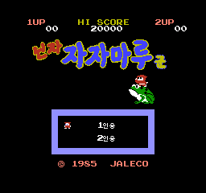
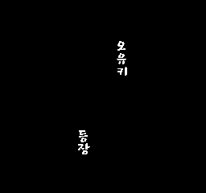
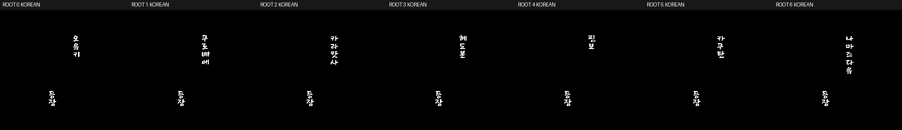

# 닌자 자자마루군 — 패미컴 / NES

패미컴 / NES **닌자 자자마루군 한글 패치 v1.0**입니다.
타이틀·인원 메뉴와 일본어 적 등장 문구 전체를 한글화했습니다.

## 다운로드 및 적용 방법

1. [v1.0 패치 ZIP 다운로드](https://github.com/akuma815/nes-ninja-jajamaru-kun-kr-patch/releases/tag/v1.0)에서 ZIP을 받아 모두 압축 해제합니다.
2. 아래 체크섬과 일치하는 일본판 원본 `.nes`를 `apply.cmd` 위에 끌어 놓습니다.
3. `Ninja_Jajamaru_kun_KR_v1.0.nes`가 생성됩니다. 원본과 기존 결과는 덮어쓰지 않습니다.
4. 다른 운영체제에서는 ZIP 안의 IPS를 IPS 패처로 적용하고 결과 SHA-256을 확인합니다.

Windows 도구는 입력·패치·출력 SHA-256을 검사하며 별도 패처 설치가 필요 없습니다.
원본 ROM·BIOS·패치된 전체 ROM은 배포하지 않습니다.

## 번역 범위

- 한글 타이틀 로고와 1인용/2인용 메뉴.
- 제주한라산체의 적 이름 7종: 오유키, 쿠로베에, 카라캇사, 헤도본, 핀보, 카쿠탄, 나마즈다유.
- 공통 `登場 → 등장` 안내.
- HUD·SCENE/PLAYER/START·PAUSE·GAME OVER·보너스의 영문은 원문 유지.

위 모음은 네이티브 출력 루틴의 A 선택값을 지정한 제어 실험 캡처입니다.
첫 적은 일반 게임 시작으로도 확인했습니다. 모든 적을 자연 진행으로 조우한 화면은 아닙니다.

## 검증과 한계

정적·빌드/IPS 적용, Mesen2.1.1 자연 시작·첫 등장·초기 플레이·reset·인원 선택/시작,
7종 출력 분기·화면 전환, 실제 Windows ZIP 적용과 오류 입력 거부를 검증했습니다.
전체 완주·실기·다른 에뮬레이터·오디오 청취 및 나머지6종의 자연 조우는 미수행입니다.
모든 숨은 문구를 확인한 완전 한글판이라는 의미는 아닙니다.

## 체크섬

| 구분 | SHA-256 |
| --- | --- |
| 일본판 원본 32,784바이트 | `c44602e4605d0c60e72a13565cdf12798262bcf22e6a70319375c250fc2ac45b` |
| v1.0 결과 | `b7e79f8de2bc76e0e09db0b2e8041b349eb051e04b73067ea231cd0117c243f9` |
| IPS | `571a29e72c3700584b2243f73f9d962483880c303a568078d42a7a443014f362` |
| 배포 ZIP | `efb84dc43454abf66753d5726d694519eaaac284be34e315119579f88d7bfacb` |

## 소스 및 작업 기록

[v1.0 상세 릴리즈 기록](docs/releases/v1.0/RELEASE_NOTES.md) · [공개 소스 빌드 안내](docs/SOURCE_GUIDE.md)

[최신 인계·로컬 폴더 정리 및 재빌드 절차](docs/HANDOFF.md). 원본 ROM을 제외한 최종 빌드 필수 파일은 이 저장소에 있습니다.

폰트 원문 라이선스는 `assets/fonts/`와 배포 ZIP의 `licenses/`에 보존했습니다.
기존 [타이틀·메뉴003 릴리즈](https://github.com/akuma815/nes-ninja-jajamaru-kun-kr-patch/releases/tag/title-menu-003)는 유지합니다.
